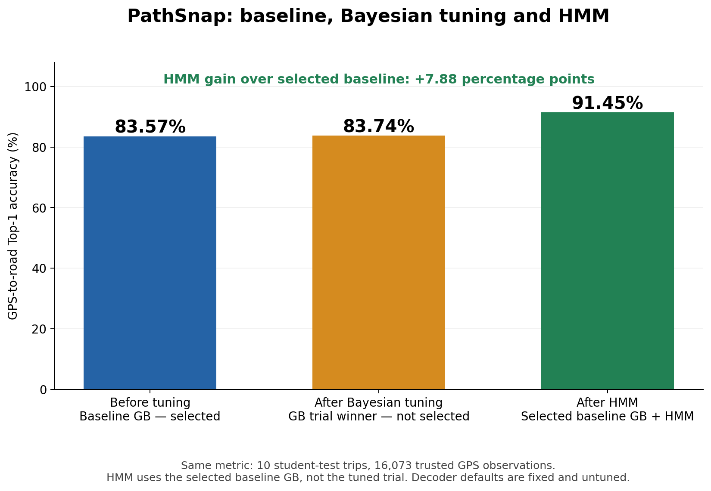

# PathSnap — Review Summary

Date: 18 November 2026

> **Measured headline:** Adding HMM/Viterbi to the selected Histogram Gradient Boosting classifier improved GPS-to-road Top-1 accuracy from **83.57% to 91.45%**, a gain of **7.88 percentage points** on the ten student-test trips.

## 1. Problem and solution

GPS readings can drift away from the actual road or appear on a parallel road. PathSnap matches these noisy observations to a directed road network and reconstructs a plausible connected route.

```text
GPS observations + road nodes/arcs
               |
Candidates within 100 m, at most 8 per observation
               |
13 physical/context features
               |
Histogram Gradient Boosting scores each candidate
               |
HMM + Viterbi selects a coherent road sequence
               |
FastAPI returns predicted routes and metrics to Streamlit
```

## 2. Data and training

| Item | Quantity / approach |
|---|---|
| Training trips | 80 |
| Training GPS observations | 208,417 |
| Trusted labelled training candidate rows | 1,070,140 |
| Student-test trips / GPS observations | 10 / 19,160 |
| Trusted student-test observations used for Top-1 | 16,073 |
| Validation | Five fixed folds grouped by trip |
| Final classifier fit | All trusted labelled rows from all 80 training trips |
| Evaluator partition | Separate; not used for development or the results below |

Each trip has `.track` (GPS longitude, latitude, time), `.nodes` (map coordinates), `.arcs` (directed node connections) and `.route` (reference arc sequence). Reference-route alignment derives observation-level labels; uncertain labels are excluded from fitting. The reference route is not a prediction input.

The 13 features describe candidate distance/rank, relative proximity, heading agreement, speed, segment length, projection position, candidate count, one-way structure, endpoint degrees, and previous/next-point proximity. Learned preprocessing is fitted inside each training fold. No observations from a trip are split between training and validation.

Evidence: [data/model report](data_and_models.md), [coverage totals](../../results/eda/coverage_by_partition.csv).

## 3. Five-model comparison

CV macro-F1 is the mean over the five training folds. All remaining columns below are student-test results. Higher accuracy/F1 is better; lower log loss is better.

| Model | CV macro-F1 | Candidate accuracy | GPS Top-1 | Test macro-F1 | Test log loss |
|---|---:|---:|---:|---:|---:|
| Logistic Regression | 86.72% | 94.44% | 82.79% | 88.95% | 0.153 |
| Decision Tree | 87.59% | 94.88% | 83.16% | 89.83% | 0.135 |
| Random Forest | 88.18% | 94.24% | 83.77% | 89.46% | 0.147 |
| HistGradientBoosting **(selected)** | 88.61% | 95.16% | 83.57% | 90.39% | 0.118 |
| KNN | 85.79% | 94.18% | 81.02% | 88.48% | 0.710 |

Histogram Gradient Boosting was selected because it had the highest CV macro-F1 (88.61%), highest student-test macro-F1 (90.39%), and lowest student-test log loss (0.118). Random Forest had a slightly higher classifier-only Top-1, so GB is not claimed to win every individual metric.

Evidence: [full comparison CSV](../../results/models/comparison/five_model/all_metrics.csv), [presentation table](../../results/models/comparison/five_model/deliverables_table.md).

## 4. Bayesian optimisation

A real Optuna TPE search attempted 5 trials: three random startup trials and two adaptive TPE trials. Four completed and one was pruned. The objective was mean trip-grouped training-CV macro-F1; student test was not used for fitting or searching.

The best searched objective was **0.88611685**, compared with **0.88614940** for the original GB. The search did not beat the baseline, so the original GB remained selected. The planned 20-trial study was not completed.

Evidence: [search summary](../../results/optimization/gradient_boosting_tpe_deadline/summary.json), [trial records](../../results/optimization/gradient_boosting_tpe_deadline/trials.csv).

## 5. Explicit HMM improvement

Independent classifier decisions can jump between roads. HMM uses classifier evidence and road-network transition plausibility; Viterbi finds the best sequence. This changes sequence selection rather than retraining the classifier.

| Same metric and same trusted student-test observations | Correct GPS road choices | GPS Top-1 |
|---|---:|---:|
| Selected GB alone | 13,432 / 16,073 | 83.5687% |
| Selected GB + HMM/Viterbi | 14,699 / 16,073 | 91.4515% |
| Improvement | **1,267 additional correct choices** | **+7.8828 percentage points** |

**Gain calculation: (0.9145150252 − 0.8356871773) × 100 = 7.8828 percentage points, rounded to +7.88.**

### Why 95.16% and 91.45% are not a decrease

- **Candidate accuracy (95.16%)** asks whether each GPS–road pair is correctly classified as a match or non-match. Most pairs are non-matches.
- **GPS Top-1** asks whether the selected road is the reference road for each trusted GPS observation.
- The comparable before/after figures are **83.57% → 91.45%**. Do not subtract 91.45% from 95.16% to describe the HMM effect.

Accuracy here is agreement with derived reference alignment, not independently verified physical ground truth. Trusted observations with missing reference candidates or no candidates count as Top-1 failures. Uncertain reference alignments are excluded from this denominator.

### Per-trip evidence

| Student-test trip | Trusted observations | Classifier Top-1 | HMM Top-1 | Gain (percentage points) |
|---|---:|---:|---:|---:|
| 00000052 | 203 | 98.03% | 100.00% | +1.97 |
| 00000065 | 628 | 85.83% | 92.20% | +6.37 |
| 00000091 | 691 | 83.65% | 92.91% | +9.26 |
| 00000009 | 693 | 81.67% | 88.60% | +6.93 |
| 00000007 | 1,283 | 91.82% | 88.15% | -3.66 |
| 00000076 | 987 | 86.12% | 97.57% | +11.45 |
| 00000000 | 2,357 | 94.27% | 96.73% | +2.46 |
| 00000040 | 2,754 | 88.96% | 97.39% | +8.42 |
| 00000077 | 3,533 | 64.00% | 78.86% | +14.86 |
| 00000056 | 2,944 | 87.94% | 95.75% | +7.81 |

The aggregate is observation-weighted (total correct / total trusted observations), not an unweighted average of trip percentages. HMM does not improve every trip; trip 00000007 becomes worse.

Evidence: [aggregate rehearsal summary](../../results/rehearsal/summary.json), [per-trip HTTP/offline measurements](../../results/rehearsal/student_test_api.csv). All ten recorded HTTP outputs matched offline geometry and metrics.

## 6. What to demonstrate in the UI

1. **Connection and real model.** Show the green API status, the API address pointing to Laptop 1, and the selected Gradient Boosting model. A stub response is not a real prediction.
2. **Trip selection.** Show the ten discovered student-test trip IDs. Start with `00000052` for a short, quick example, then choose a different trip to show that the outputs change.
3. **Run Prediction.** Click the button and let the request complete. Keep the UI terminal open on Laptop 2 and the API receiving log visible on Laptop 1.
4. **Compare the map layers.** Orange dots are raw GPS observations, green lines are the classifier-only prediction, and blue lines are the HMM prediction. Toggle the layer control and zoom near a junction or parallel roads. Green is not the reference route in this UI.
5. **Compare the three metric cards.** Explain Classifier Top-1, HMM Top-1 and candidate miss rate. These cards are for the selected trip; the 91.45% aggregate belongs to all ten trips in this report.
6. **Show diagnostics and timings.** Expand/read the metrics JSON, model/decoder versions, request ID and stage timings. Match the request ID/trip in the receiving API console to prove that Laptop 2 called Laptop 1.
7. **Show a second example and the report.** The shortest/median/longest development-map examples are trips `00000052`, `00000056`, `00000076`. If discussing limitations, show trip `00000007`, where smoothing worsens Top-1. Use the aggregate comparison above for the overall conclusion.

GPS display sampling on long trips affects rendering only; inference uses every observation. Reference routes and labels remain server-side and must not be displayed as prediction inputs.

## 7. Deployment and scope

| Component | Location / responsibility |
|---|---|
| Laptop 1 | Model, feature/candidate processing, HMM/Viterbi, FastAPI and reference-based evaluation |
| Laptop 2 | Streamlit UI; sends selected trip ID and displays returned predictions |
| Demo API port | 8020 |
| Laptop 2 local UI port | 8520 |
| Model version | `hgb-baseline-ac522dfa` |
| Decoder version | `development-untuned-v1` |

Launch instructions: [quick two-laptop demo](../QUICK_DEMO.md).

**Scope:** The classifier has been selected and the demo performs real HMM inference, but the decoder uses fixed untuned defaults. Final decoder tuning, strict final deployment packaging, reserved evaluator results, and a recorded physical two-laptop acceptance test are not established by the loopback rehearsal. The evaluator archive was not opened for these results. A successful live two-laptop demonstration should be recorded separately.

## 8. Short explanation for the review

> PathSnap reconstructs vehicle routes from noisy GPS observations. We compared five classifiers using five-fold trip-grouped validation and selected Histogram Gradient Boosting. Adding HMM/Viterbi improved trusted GPS-to-road Top-1 accuracy from 83.57% to 91.45% on ten student-test trips, a gain of 7.88 percentage points. The model runs behind FastAPI on Laptop 1, and the Streamlit interface runs on Laptop 2. The recorded HMM result uses fixed untuned decoder defaults.

## 9. Review graphs



The middle bar is the tuned trial, which was not selected. The HMM bar uses the
retained baseline GB. Thus this is a comparison of alternatives, not a claim
that the tuned model was fed into HMM. The HMM gain remains +7.88 percentage
points over the selected baseline.

- [Detailed before/after tuning graph](../../results/figures/review/02_before_after_tuning.png)
- [Before/after HMM for every student-test trip](../../results/figures/review/03_hmm_per_trip.png)
- [PNG/SVG gallery and plotting evidence](../../results/figures/review/README.md)

The tuned model improves student-test Top-1 slightly (83.57% to 83.74%) but has
slightly lower training-CV macro-F1, the declared selection objective. The
baseline was therefore retained. HMM results for the tuned model are not claimed.
