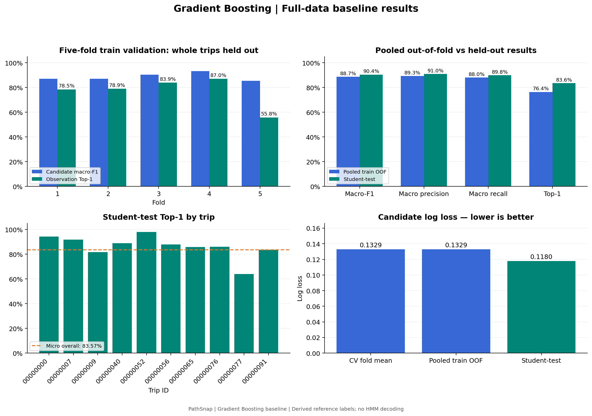
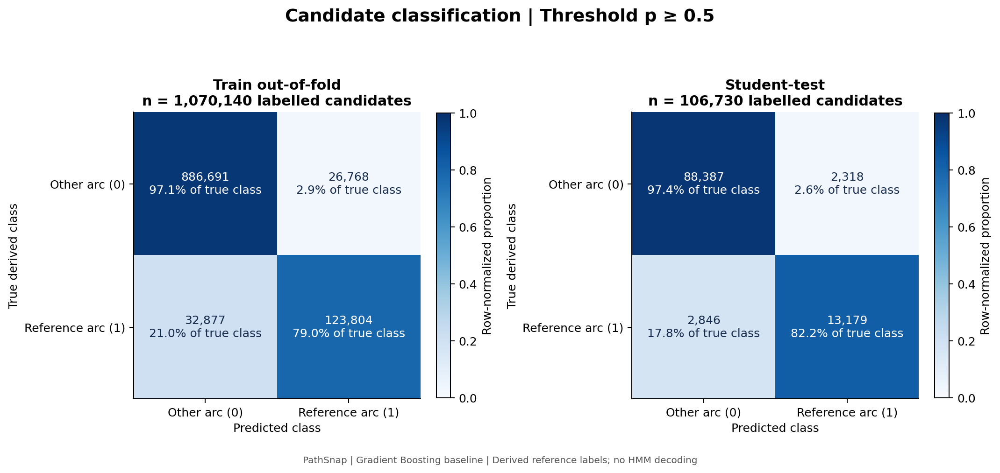
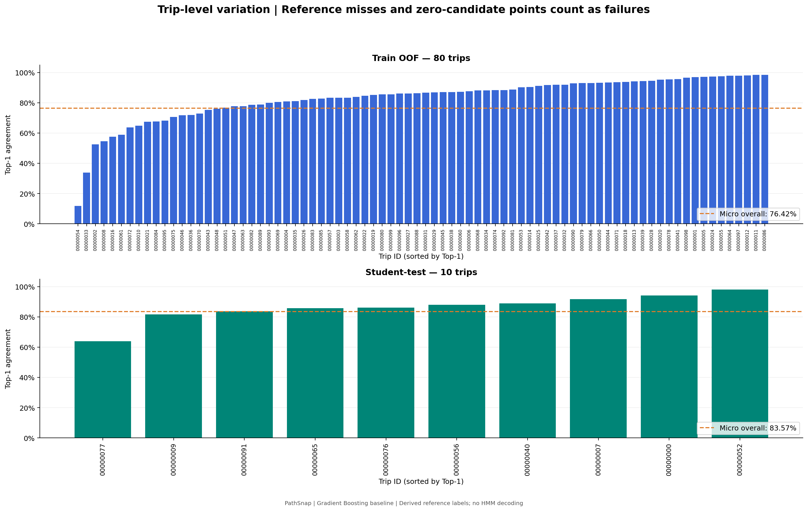
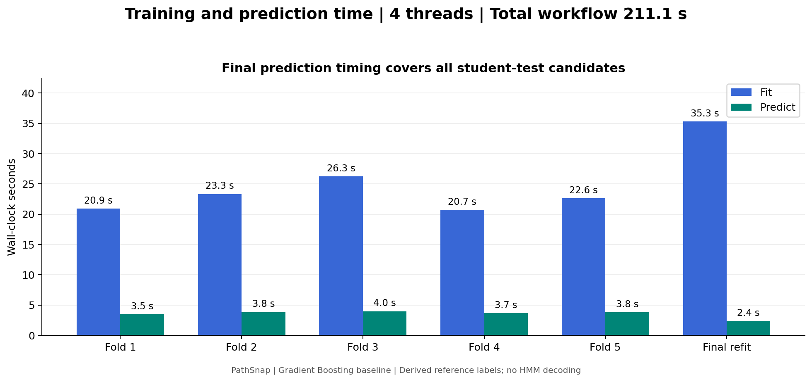
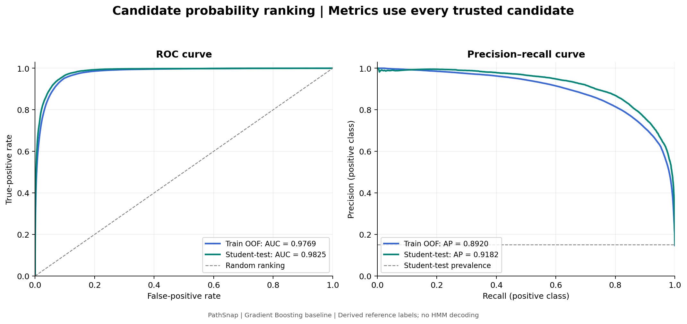
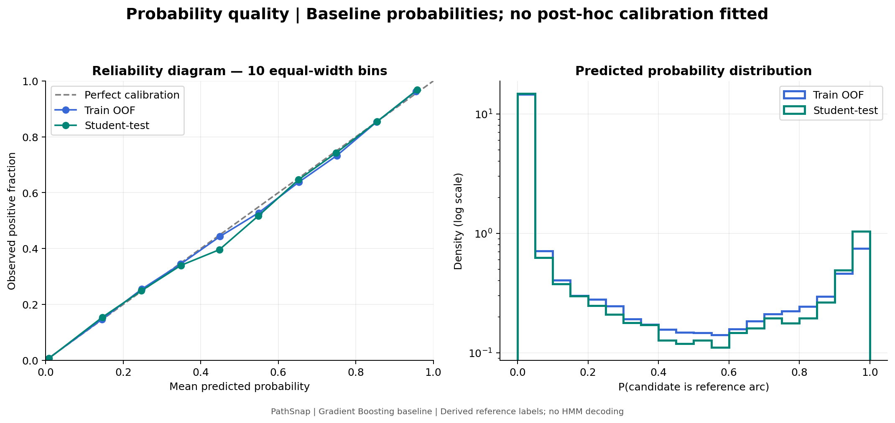

# Gradient Boosting graphs

All figures use saved full-data baseline results. Blue is held-out train OOF;
teal is student-test. Reference labels come from approximate offline alignment.
PNG images are suitable for slides; matching SVGs provide scalable report output.

Recreate without training:

```powershell
python -m src.evaluation.plot_gradient_boosting
```

Install dependencies and download dataset/model probability assets as documented
in [the model report](../../../../report/gradient_boosting.md).
Source checksums are recorded in `figure_manifest.json`.

## Performance overview



## Confusion matrices

Counts and row-normalized percentages for trusted labelled candidates;
classification threshold is 0.5. Candidate classification differs from choosing
one road arc per GPS observation.



## Per-trip Top-1

Every valid observation with a trusted reference contributes to its denominator.
Missing-reference candidates and zero-candidate observations count as failures.
The dashed line is the observation-weighted overall score, not the trip mean.



## Measured runtime



## ROC and precision–recall

Curves use trusted labelled candidates. Display lines are limited to 2000 empirical
points per curve; AUC and average precision use all rows.



## Probability quality

Ten equal-width reliability bins and prediction distributions. These inspect
baseline calibration; no post-hoc calibrator was fitted.


